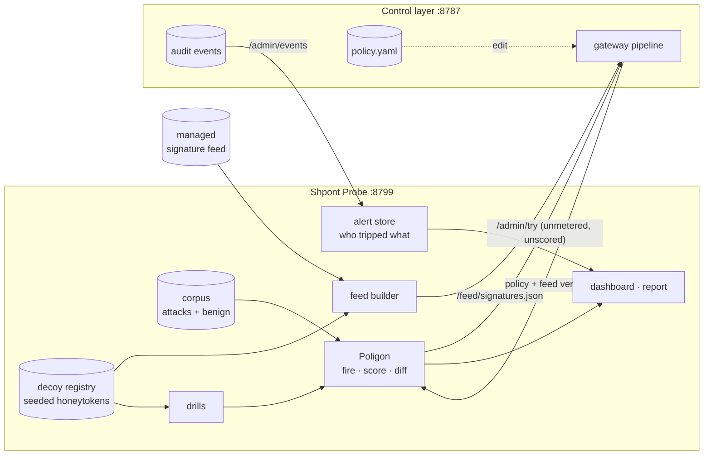

# Shpont Probe

Two modules that sit next to an AI control layer and answer the two questions a message filter cannot:

- **Poligon**: *how good is the control layer right now, and what did my last config edit just open?*
  It fires a corpus of attacks and legitimate requests at the live layer, continuously, and turns the result into a measured posture score. When the policy or the signature feed changes, it re-fires within seconds and lists the attacks the change let through.
- **Tripwire**: *is someone inside already misusing access?*
  It plants decoys: credentials, records and resources that belong to nobody. Nothing legitimate ever touches one, so a hit is a confirmed incident with a name on it. No model, no threshold, no false positives.

Built against [Shpont-Shield](https://github.com/HackNuggets2026/Shpont-Shield) and needs **no change in its code**: Poligon drives the gateway's admin API, Tripwire publishes its decoys through the signature feed the gateway already consumes.



## The stage

`/` is one screen built for a projector. Both halves are driven by the same live data, nothing is scripted.

- **Shield, plan view.** The control layer drawn as rings in the order it evaluates them: access, budgets, deterministic checks, contextual PII, semantic controls. Each arc is one control and takes its state from the live policy: enforcing, log-only, shadow or switched off. Every dot is a payload Poligon fired at the real layer; it stops on the control that stopped it. A dot that reaches the centre is an attack that got through. The centre shows the measured posture score.
- **Cross-section.** The same pipeline cut the other way: stages as floors, the five kinds of traffic as lanes (prompt, tool call, model reply, tool result, tool listing). Each cell counts what was stopped there, the vault row counts what was delivered.
- **Decoy rooms.** One room per Tripwire decoy. A real hit lights the room, flashes its marker on the shield and names the agent.
- **Change banner.** Edit the policy or the feed: within about three seconds the affected arc changes state, the banner states the posture delta and what is now getting through, and the dots start passing the open arc.
- **Live traffic.** Real requests through the gateway (not self-test) fly in as larger dots labelled with the principal.

`/details` has the full lists (open attacks, false positives, evasions, feed self-test) for the security team. Press `f` on the stage for full screen.

## Quick start

```bash
python -m venv .venv && .venv/bin/pip install -e '.[dev]'
.venv/bin/python -m pytest          # 54 tests, ~2 s; 4 of them run against the real Shield in-process

# Shield checked out next to this repo, with its own .venv (see its README):
demo/up.sh                          # starts both, decoys planted
.venv/bin/python demo/intruder.py   # a scripted break-in: 6 of 7 steps stopped, 1 passes by design
.venv/bin/shpont-probe run          # one corpus run in the terminal; --min-posture 85 for CI
```

Open http://127.0.0.1:8799/, then edit `.run/policy.yaml` (set a control's `mode: log`, raise a threshold, delete a signature from the feed). The posture score and the "What configuration changes did" panel update within about three seconds.

## Poligon

| Number | Meaning |
|---|---|
| **protection** | share of attacks stopped (blocked or redacted) |
| **friction** | share of legitimate requests stopped: what the guardrails cost developers |
| **evasion** | share of rewritten attacks still stopped, counted only for attacks whose original is stopped |
| **posture** | `protection x (1 - friction)`, 0 to 100. Blocking everything scores 0, and so does blocking nothing |

- **Corpus** (`corpus/`): YAML, one file per attack class. `attacks/` must be stopped, `benign/` must pass. `benign/hard.yaml` holds legitimate requests that use security vocabulary, which is where over-eager guardrails show. Add a case by adding three lines.
- **Mutators** (`poligon/mutate.py`): upper-case, leetspeak, homoglyphs, zero-width characters, letter spacing, base64 wrapping, role-play framing. Classes whose payload a rewrite would destroy (keys, card numbers, exploit strings) are marked `mutable: false`.
- **Impact of a change**: every re-run is compared with the previous one case by case. The log names the attacks that opened or closed, the false positives that appeared or went away, and which part of the configuration changed (policy, feed, controls, semantic backend, insider-risk levels).
- **Feed self-test**: a signature may carry `tests: {match: [...], clean: [...]}`. One that does not compile, misses its own example or fires on clean text is reported as broken (`shpont-probe feed --check`).

Self-test traffic goes through the gateway's `/admin/try`, which runs the full pipeline but spends no budget and adds no insider-risk points.

## Tripwire

| Class | What it is | Trips on |
|---|---|---|
| **trap** | a credential or resource nobody has a reason to touch | any sighting, in any direction |
| **marker** | a fake record inside real data | `tool_call` only: reading it is normal work, moving it on is not |
| **canary** | a string placed in a system prompt | `output` and `tool_call`: the hidden instructions leaked |

Honeytokens are derived from a seed with HMAC (`tripwire/tokens.py`): the same seed gives the same tokens after a restart, and they cannot be guessed without it. Each decoy becomes one signature in the feed. The pattern requires only the letters and digits in order, so `A K I A ...`, a dash-less or a lower-cased copy still trips, and the base64, hex, reversed and URL-encoded forms are matched too.

Alerts come from the control layer's own audit trail, so they carry principal, team, role, channel, direction and tool. Trips caused by Poligon's drills are counted separately and never raise an incident.

```bash
.venv/bin/shpont-probe tokens            # what is planted, values masked
.venv/bin/shpont-probe tokens --reveal   # full values, e.g. to paste the canary into a system prompt
.venv/bin/shpont-probe plant --policy ../Shpont-Shield/policy.yaml --out .run/policy.yaml
```

## Configuration

Everything is in [`probe.yaml`](probe.yaml): the target, the corpus, the decoys and where each one is planted.

## Endpoints

| Endpoint | For |
|---|---|
| `/` | the stage: shield, cross-section, decoy rooms |
| `/details` | detail dashboard for the security team |
| `/api/stage` | rings, per-payload outcomes, live traffic and decoy state for the stage |
| `/feed/signatures.json` | the managed feed plus one signature per decoy; point the control layer's `signatures.feed` here |
| `/api/state` | everything the dashboard shows, as JSON |
| `/api/report.md`, `/api/report.json` | posture report for management and for the security team |
| `POST /api/run` | fire the corpus now |
| `POST /api/scan` | check any text against the decoys directly (SDK-style use, no gateway needed) |

## What was measured on Shield

With the shipped policy and the keyword stand-in for the decision model (no GPU), on a laptop:

| | |
|---|---|
| posture | 91.4 / 100 |
| protection | 69 of 73 attacks stopped |
| friction | 1 of 30 legitimate requests stopped |
| evasion | 92 of 203 rewrites stopped |
| a full run | 320 cases in 0.4 s, in-layer p95 2.9 ms |

The four open attacks, the false positive and the weak evasion techniques (base64 wrapping, letter spacing, homoglyphs, leetspeak) are listed on the dashboard and in [docs/findings.md](docs/findings.md). They are expected to move once the real decision models replace the keyword stand-in.

## Limits

- Poligon measures against the corpus it has. A score of 100 means "stops everything we know", not "secure".
- `/admin/try` takes no tool name or model, so tool-RBAC and model-allowlist rules are not exercised by the corpus yet.
- Self-test runs appear in the control layer's audit trail under the `dashboard` channel.
- A decoy only catches what touches it. It complements content inspection, it does not replace it.
- State is in memory, except tripwire alerts, which are appended to `data/tripwire-alerts.jsonl`.

See [docs/architecture.md](docs/architecture.md) for the layout and the seams left for the next modules.
