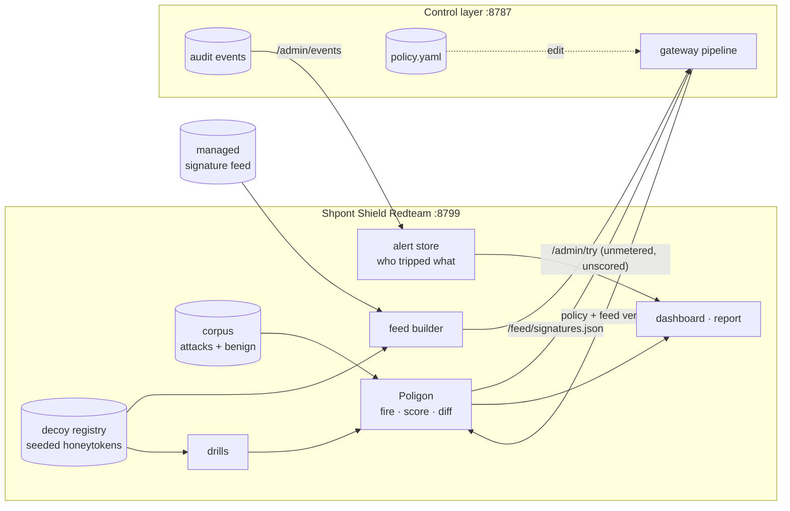

# Shpont Shield Redteam

Modules that sit next to an AI control layer and answer the questions a message filter cannot. The first two are the core:

- **Poligon**: *how good is the control layer right now, and what did my last config edit just open?*
  It fires a corpus of attacks and legitimate requests at the live layer, continuously, and turns the result into a measured posture score. When the policy or the signature feed changes, it re-fires within seconds and lists the attacks the change let through.
- **Tripwire**: *is someone inside already misusing access?*
  It plants decoys: credentials, records and resources that belong to nobody. Nothing legitimate ever touches one, so a hit is a confirmed incident with a name on it. No model, no threshold, no false positives.

Around them: **Referee** (the same corpus against every control layer the team built), **Data trail** (customer data an agent read, stopped when another agent tries to send it out), **Memory guard** (what agents keep in long-term memory), **Reach map** (who could leak data if one instruction were planted), **What-if** (a settings change previewed on a sandboxed copy) and **Autopatch** (rules written from attacks that got through, proven before they are offered).

Built against [Shpont-Shield](https://github.com/HackNuggets2026/Shpont-Shield) and needs **no change in its code**: Poligon drives the gateway's admin API, Tripwire publishes its decoys through the signature feed the gateway already consumes.



## Fixing what Poligon finds

- **Reach map** (`shield_redteam/reach/`). Reads people, agents, role tool permissions, resource entitlements and agent grants from Shield and finds identities that hold three capabilities at once: reading private data, taking in content written by outsiders, and sending data out. That combination is what turns one planted instruction into a data leak. For each, it names the capability with the fewest sources and ranks single changes (a tool removed from a role, a grant revoked) by how many combinations they break. `GET /api/reach`.
- **What-if** (`shield_redteam/whatif/`). Runs a private copy of Shield (same code, candidate policy, no live traffic) and replays both the corpus and recent real requests through the current and the candidate configuration. Shows the score change, the attacks a change would open or close, and which real people's requests would now be blocked. `POST /api/whatif`, then `POST /api/whatif/apply` to write the change to the live policy file. Real requests are replayed unmasked only when the policy keeps raw audit text (`plant --record-raw`, demo only); otherwise masked text is replayed.
- **Autopatch** (`shield_redteam/autopatch/`). For every attack that gets through, writes a signature from a phrase of that attack which no legitimate test message contains, then proves it in the sandbox: it must stop the attack and block no legitimate test message or real request that was not blocked before. Proven patches are applied with one click and published through the same signature feed Shield already reads. `GET /api/patches`, `POST /api/patches/apply`, `POST /api/patches/revert`. Disguised (encoded, spaced-out) variants need input normalisation in Shield, which one pattern cannot provide.

## Referee

The team built four control layers. The Referee fires the same corpus (trap drills excluded) at all of them and puts the results side by side: score, attacks stopped, normal requests blocked, disguised attacks stopped, latency, per attack class, the best gateway for each class, and attacks none of them stops. `demo/referee-up.sh` clones and starts the other three locally with their own demo policies (ports 8801-8803); the list lives under `referee.gateways` in `redteam.yaml`. Each runs offline (keyword or stand-in models), and the corpus was written against Shield, so read the numbers as a comparison of default demo setups, not of the products at their best. `GET /api/referee`, `POST /api/referee/run`.

## Memory guard

Long-term memory lets an agent be misled later by something it read once. `shield_redteam/memory/` is a memory API for agents that keeps where every entry came from: content from email, web pages or documents is checked by Shield before it is kept; an entry that tries to give orders, or a burst of near-identical entries, is quarantined until a person releases it; on recall, outside content comes back as labelled reference material, and an agent reads only its own namespace and the shared ones it is given. This covers memory poisoning, which the team's other repositories list as out of scope (OWASP LLM04 and LLM08). A six-scenario self-test runs against the live layer. `POST /api/memory/write`, `/api/memory/recall`, `/api/memory/release`, `/api/memory/selftest`, `GET /api/memory`.

## Data trail

Detectors recognise card numbers and keys, not a customer's name or a contract number, and each step of a leak can look harmless: one agent reads a CRM record, a later call by another agent sends the name to an outside site. `shield_redteam/trail/` reads the tool results of real traffic, remembers the values returned under sensitive field names (name, contract, account, email and similar) for 24 hours, and publishes each as a signature that applies only to outgoing tool calls. Reading the data stays allowed; sending it out is blocked, and every stopped attempt is linked back to who read the value, through which tool and when. Only values are learned, from traffic Shield already inspects; the dashboard shows them masked. Because the feed now carries those values, `/feed/signatures.json` requires `?token=` (`REDTEAM_FEED_TOKEN`, or derived from the seed; `plant` writes it into the policy). Learning reads the raw text Shield keeps only with `plant --record-raw` (demo only). Try it with `python demo/trail.py` or the "Play a two-step leak" button. `GET /api/trail`, `POST /api/trail/demo`.

## The dashboard

`/` is a React app (`web/`: React, TypeScript, Tailwind, shadcn/ui, Recharts, Animate UI and Magic UI for motion) with light and dark themes. The left navigation groups twelve tabs by what they are for. Every block is titled with the question it answers and is drawn from the live layer. The built bundle ships inside the Python package, so there is no Node at runtime.

| Tab | Shows | Wired to |
|---|---|---|
| **Start here** | what the project is and what this repository adds, every tab in one line, a two-minute demo path; Polish and English | live numbers from the other tabs |
| **Overview** | four key numbers; the score ring; a pipeline drawing (attacks and normal requests pass five stages; each lane narrows by what a stage caught, and the safeguards under each stage are switches); score per run with a dot on every settings change and a change log that opens the affected attacks; live test messages | the last corpus run and Poligon's change log; clicking a safeguard under a stage switches it off |
| ***Find holes*** | | |
| **Attacks** | coverage map (attack type by channel), disguise radar, filterable lists of attacks that pass, wrong blocks and evasions, with a detail drawer per case | per-case outcomes and evasion mutants |
| **Safeguards** | every control grouped by stage, with a switch and a stopped / got-through bar | the switch flips `enabled` in Shield's real policy file, the corpus is re-fired, a toast offers undo |
| **Playground** | write any message, pick the channel, see which safeguard reacted and how fast | the live layer, unmetered |
| **Referee** | one card per team gateway (score, attacks stopped, wrong blocks, disguised attacks stopped, latency), share stopped per attack class, the best gateway per class and attacks none of them stops | the four gateways listed under `referee.gateways` |
| ***Catch leaks*** | | |
| **Traps** | one card per Tripwire decoy with "Simulate theft", and an incident timeline naming who used it | a real request with an agent key, then Shield's audit trail |
| **Data trail** | the latest stopped attempt drawn as a chain (read by, tried to leave via, blocked), earlier attempts, and the values being traced, masked; "Play a two-step leak" | real tool results and outgoing calls in Shield's audit trail |
| **Memory guard** | memories kept per agent with source and trust, quarantined entries with a release button, a write-and-recall form, the six-scenario self-test | the memory API, with Shield inspecting outside content |
| **Reach map** | who can reach what, the identities holding all three dangerous capabilities, and the single changes that break them | Shield's identities, roles, entitlements and grants, plus the Common-Database directory |
| ***Fix*** | | |
| **What-if** | draft a settings change, preview it on test attacks and real requests, then apply it | a sandboxed copy of Shield |
| **Autopatch** | proposed rules with their proof (score before and after, cases closed, legitimate requests affected), apply and revert | the sandbox, then the signature feed |

`/console` shows the same data as five tabs inside the Shield security console shell: Redteam's part there is one file, `shield_redteam/server/static/console/views/redteam.js`, written against Shield's `docs/console-contract.md`. To merge into Shield: copy it into `controllayer/dashboard/views/`, add its script tag to `panel.html`, set `window.REDTEAM_API` to the Redteam service.

The switches need `target.policy_file` in `redteam.yaml` (set by `demo/up.sh`); the theft button needs `target.demo_agent_key`.

## Shared organisation (Common-Database)

`demo/up.sh` loads the team's shared organisation (ACME Bank, 120 people and 39 agents) when [Common-Database](https://github.com/HackNuggets2026/Common-Database) is checked out next to this repo (or `COMMON_DB=<path>`): the target Shield is seeded with its people, agents, grants and history, and the trap log gets a demo history. The Reach map reads the people from the policy's `identity.directory`.

## Quick start

```bash
python -m venv .venv && .venv/bin/pip install -e '.[dev]'
.venv/bin/python -m pytest          # 58 tests, ~2 s; 4 of them run against the real Shield in-process

# Shield checked out next to this repo, with its own .venv (see its README):
demo/up.sh                          # starts both, decoys planted
.venv/bin/python demo/intruder.py   # a scripted break-in: 6 of 7 steps stopped, 1 passes by design
.venv/bin/shield-redteam run          # one corpus run in the terminal; --min-posture 85 for CI
```

Open http://127.0.0.1:8799/, then edit `.run/policy.yaml` (set a control's `mode: log`, raise a threshold, delete a signature from the feed). The score and the "What the last settings change did" card update within about three seconds.

## Poligon

| Number | Meaning |
|---|---|
| **protection** | share of attacks stopped (blocked or redacted) |
| **friction** | share of legitimate requests stopped: what the guardrails cost developers |
| **evasion** | share of rewritten attacks still stopped, counted only for attacks whose original is stopped |
| **posture** | `protection x (1 - friction)`, 0 to 100. Blocking everything scores 0, and so does blocking nothing |

- **Corpus** (`corpus/`): YAML, one file per attack class. `attacks/` must be stopped, `benign/` must pass. `benign/hard.yaml` holds legitimate requests that use security vocabulary, which is where over-eager guardrails show. Add a case by adding three lines.
- **Mutators** (`poligon/mutate.py`): upper-case, leetspeak, homoglyphs, zero-width characters, letter spacing, base64 wrapping, role-play framing. Classes whose payload a rewrite would destroy (keys, card numbers, exploit strings) are marked `mutable: false`.
- **Impact of a change**: every re-run is compared with the previous one case by case. The log names the attacks that opened or closed, the false positives that appeared or went away, and which part of the configuration changed (policy, feed, controls, semantic backend, insider-risk levels).
- **Feed self-test**: a signature may carry `tests: {match: [...], clean: [...]}`. One that does not compile, misses its own example or fires on clean text is reported as broken (`shield-redteam feed --check`).

Self-test traffic goes through the gateway's `/admin/try`, which runs the full pipeline but spends no budget and adds no insider-risk points.

## Tripwire

| Class | What it is | Trips on |
|---|---|---|
| **trap** | a credential or resource nobody has a reason to touch | any sighting, in any direction |
| **marker** | a fake record inside real data | `tool_call` only: reading it is normal work, moving it on is not |
| **canary** | a string placed in a system prompt | `output` and `tool_call`: the hidden instructions leaked |

Honeytokens are derived from a seed with HMAC (`tripwire/tokens.py`): the same seed gives the same tokens after a restart, and they cannot be guessed without it. Each decoy becomes one signature in the feed. The pattern requires only the letters and digits in order, so `A K I A ...`, a dash-less or a lower-cased copy still trips, and the base64, hex, reversed and URL-encoded forms are matched too.

Alerts come from the control layer's own audit trail, so they carry principal, team, role, channel, direction and tool. Trips caused by Poligon's drills are counted separately and never raise an incident.

```bash
.venv/bin/shield-redteam tokens            # what is planted, values masked
.venv/bin/shield-redteam tokens --reveal   # full values, e.g. to paste the canary into a system prompt
.venv/bin/shield-redteam plant --policy ../Shpont-Shield/policy.yaml --out .run/policy.yaml
```

## Configuration

Everything is in [`redteam.yaml`](redteam.yaml): the target, the corpus, the decoys and where each one is planted.

## Endpoints

| Endpoint | For |
|---|---|
| `/` | the dashboard |
| `/console` | the same data as tabs in the Shield console shell |
| `/api/stage` | controls in evaluation order with live state, and where each payload stopped |
| `/feed/signatures.json?token=` | the managed feed plus one signature per decoy and per traced value; point the control layer's `signatures.feed` here |
| `/api/state` | everything the dashboard shows, as JSON |
| `/api/report.md`, `/api/report.json` | posture report for management and for the security team |
| `POST /api/run` | fire the corpus now |
| `POST /api/control`, `/api/try`, `/api/steal` | the three hands-on actions of the panel |
| `POST /api/scan` | check any text against the decoys directly (SDK-style use, no gateway needed) |

## What was measured on Shield

With the shipped policy and the keyword stand-in for the decision model (no GPU), on a laptop:

| | |
|---|---|
| posture | 91.4 / 100 |
| protection | 69 of 73 attacks stopped |
| friction | 1 of 30 legitimate requests stopped |
| evasion | 92 of 203 rewrites stopped |
| a full run | 320 cases in 0.4 s, in-layer p95 2.9 ms |

The four open attacks, the false positive and the weak evasion techniques (base64 wrapping, letter spacing, homoglyphs, leetspeak) are listed on the dashboard and in [docs/findings.md](docs/findings.md). They are expected to move once the real decision models replace the keyword stand-in.

## Limits

- Poligon measures against the corpus it has. A score of 100 means "stops everything we know", not "secure".
- `/admin/try` takes no tool name or model, so tool-RBAC and model-allowlist rules are not exercised by the corpus yet.
- Self-test runs appear in the control layer's audit trail under the `dashboard` channel.
- A decoy only catches what touches it. It complements content inspection, it does not replace it.
- The data trail only follows values that came back in JSON under a recognisable field name, and only exact (case- and spacing-tolerant) copies; a paraphrased or translated value gets past it.
- State is in memory, except tripwire alerts, which are appended to `data/tripwire-alerts.jsonl`.

See [docs/architecture.md](docs/architecture.md) for the layout and the seams left for the next modules.
